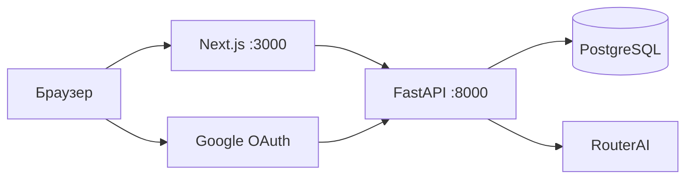
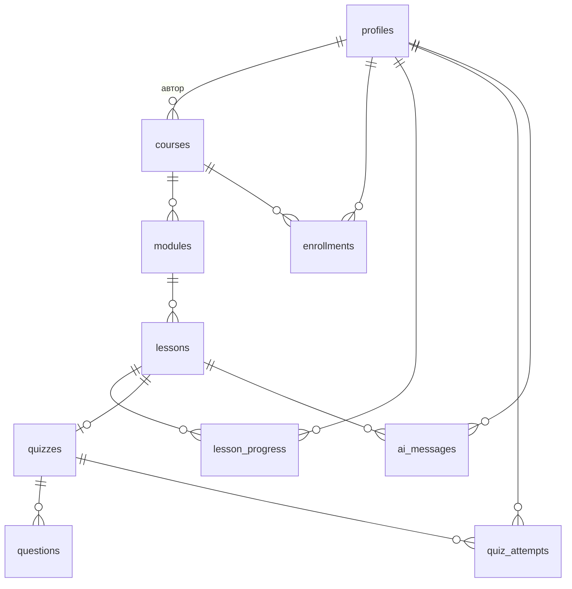

# SkillPath AI

Платформа онлайн-курсов. Студент проходит уроки, сдаёт тесты, а ИИ-наставник объясняет ошибки в ответах и отвечает на вопросы по тексту урока.

Проектная работа. Backend на FastAPI и PostgreSQL, фронтенд на Next.js, наставник работает через RouterAI.

**Работающий стенд: https://demo.ciferkaservice.online:8443**
Регистрироваться не нужно: на главной кнопки «Войти как студент» и «Войти как админ». Данные сбрасываются каждую ночь.

## Что есть

- Каталог курсов с поиском, фильтрами по категории и уровню
- Курс из модулей и уроков, текст в markdown, видео и PDF
- Тесты с проходным баллом 70%, разбор каждого ответа
- ИИ-наставник в уроке: объяснить проще, привести пример, разобрать ошибки теста, план повторения, свободный вопрос
- Дашборд: активные курсы, прогресс, последние тесты, рекомендации
- Админка: курсы, модули, уроки, тесты, загрузка файлов
- Вход через Google, роли student и admin

## Стек

- Backend: Python 3.11+, FastAPI, SQLAlchemy 2, Alembic, PyJWT, authlib, httpx
- База: PostgreSQL (в Docker), SQLite в тестах
- Frontend: Next.js 14, React, TypeScript, Tailwind
- ИИ: RouterAI, модель `qwen/qwen3.5-flash-02-23`
- Инфраструктура: Docker Compose, GitHub Actions

## Как устроено



Ключ RouterAI лежит только на сервере. Правильные ответы теста браузеру не отдаются, пока попытка не отправлена.

## База данных



Десять таблиц, модели в `backend/app/models.py`, миграция в `backend/alembic/versions/`. Паролей в базе нет.

## Запуск через Docker

```bash
cp .env.example .env     # заполнить JWT_SECRET, ключи Google и RouterAI
docker compose up --build
```

Фронт: http://localhost:3000, API и документация: http://localhost:8000/docs. Миграции применяются при старте контейнера `api`.

Первичные данные (3 курса и администратор `admin@skillpath.local`):

```bash
docker compose exec api python -m app.seed
```

## Запуск без Docker

Backend:

```bash
cd backend
python -m venv .venv && .venv\Scripts\activate     # Linux: source .venv/bin/activate
pip install -r requirements-dev.txt
cp .env.example .env
alembic upgrade head
python -m app.seed
uvicorn app.main:app --reload
```

Frontend:

```bash
cd frontend
cp .env.example .env.local
npm install
npm run dev
```

## Переменные окружения

| Переменная | Для чего |
|---|---|
| `DATABASE_URL` | строка подключения (по умолчанию SQLite-файл) |
| `JWT_SECRET` | секрет токенов; с дефолтным значением приложение не запустится на не-локальном адресе |
| `GOOGLE_CLIENT_ID`, `GOOGLE_CLIENT_SECRET` | вход через Google |
| `BACKEND_URL`, `FRONTEND_URL` | адреса для редиректов и CORS |
| `ADMIN_EMAILS` | почты через запятую, которым при входе выдаётся роль admin |
| `ROUTERAI_API_KEY`, `AI_BASE_URL`, `AI_MODEL` | ИИ-наставник |
| `ENABLE_DEV_LOGIN` | вход по email без Google, только для демо и разработки |
| `UPLOAD_DIR`, `MAX_UPLOAD_MB` | загрузка файлов |
| `NEXT_PUBLIC_API_URL`, `NEXT_PUBLIC_ENABLE_DEV_LOGIN` | настройки фронта |

## Google OAuth

В Google Cloud Console создать OAuth client типа Web application и добавить redirect URI
`{BACKEND_URL}/api/auth/google/callback`, например `http://localhost:8000/api/auth/google/callback`.

## Тесты

```bash
cd backend
python -m pytest -q
python -m ruff check .

cd ../frontend
npm run lint && npm run typecheck && npm run build
```

В backend 207 тестов: доступы, оценка тестов, поиск, загрузка файлов, ИИ-клиент с подменой сети. Запросы к настоящему RouterAI в тестах не идут.

## API

Все пути начинаются с `/api`. Полный список в `ARCHITECTURE.md` и в `/docs`.

| Группа | Пути |
|---|---|
| Вход | `/auth/google/login`, `/auth/google/callback`, `/auth/dev-login`, `/auth/me` |
| Курсы | `GET /courses`, `/courses/categories`, `/courses/{id}`, `POST/DELETE /courses/{id}/enroll` |
| Уроки | `GET /lessons/{id}`, `POST /lessons/{id}/complete`, `GET /lessons/{id}/quiz` |
| Тесты | `POST /quizzes/{id}/attempts` |
| Кабинет | `GET /me/dashboard` |
| ИИ | `POST /ai/tutor`, `GET /ai/history` |
| Админ | `/admin/courses`, `/admin/modules`, `/admin/lessons`, `/admin/lessons/{id}/quiz`, `/admin/upload`, `/admin/stats` |

## Деплой на VPS

На сервере нужны Docker и Compose. Клонировать репозиторий, создать `.env` с боевыми значениями (свой `JWT_SECRET`, `ENABLE_DEV_LOGIN=0`, реальные адреса), затем `docker compose up -d --build`. Для HTTPS поставить перед `web` и `api` nginx или Caddy. Есть необязательный workflow `deploy.yml`, он ходит по SSH и делает `git pull` и `docker compose up`.

## Безопасность

- Пароли не хранятся, вход только через Google (демо-вход отключён по умолчанию)
- Роль выдаётся только по `ADMIN_EMAILS`, из запроса её выбрать нельзя
- Уроки и тесты доступны только записанным на курс и администраторам
- Загрузка: белый список расширений, имя файла генерируется на сервере, ограничение размера
- У ИИ-наставника лимит 20 запросов за 10 минут на пользователя, текст урока и сообщение ограничены по длине
- Вопросы вне урока и опасные темы режутся тремя слоями: стоп-список до обращения к ИИ, кодовое слово в промпте, фиксированный отказ на сервере

## Ограничения

Не проверялось: вход через Google на боевом домене, сборка Docker-образов, страницы за авторизацией в браузере. Подробности в `docs/ai-log/03-review.md`.

## Работа с ИИ-агентами

Проект сделан с Claude Code: Sonnet проектировал и проверял, Haiku-агенты писали код по областям. Промпты, результаты и найденные при ревью ошибки описаны в `docs/ai-log/`. Решения по дизайну в `docs/design/DESIGN.md`.

## Структура

```
backend/      FastAPI, модели, миграции, тесты
frontend/     Next.js
docs/         ai-log, design
.github/      CI и деплой
ARCHITECTURE.md   контракт API и страниц
```

## Демо-стенд

Попробовать без установки: https://demo.ciferkaservice.online:8443

На главной кнопки «Войти как студент» и «Войти как админ», Google-вход не нужен. Данные на стенде сбрасываются каждую ночь, у ИИ-наставника есть дневной лимит запросов. Как стенд устроен и как его поднять: [docs/deploy-demo.md](docs/deploy-demo.md).
